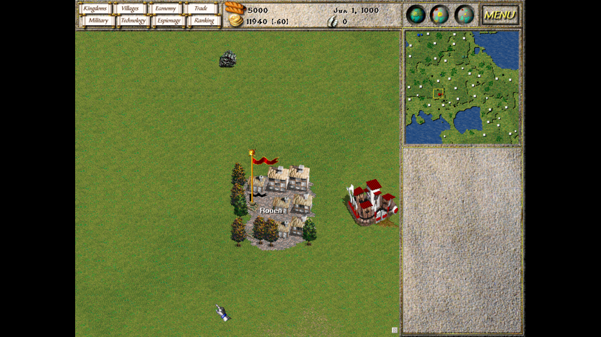

# Seven Kingdoms: Ancient Adversaries — in your browser

**[Seven Kingdoms: Ancient Adversaries](https://7kfans.com)** — Trevor Chan's classic 1997 real-time strategy game — compiled to **WebAssembly** and playable in a browser tab. No install, no download.

This is **not a remake.** It's the *real* original C++/SDL2 engine — open-sourced by Enlight Software under the GPL and maintained for years by the [7kfans](https://7kfans.com) community — compiled with [Emscripten](https://emscripten.org/). So the entire game runs: economy, trade and taxes, diplomacy, spies that defect enemy towns, independent villages and heroes, all 10 cultures, and the original AI.

▶ **[Play it in your browser](https://redlocomotive.itch.io/seven-kingdoms-ancient-adversaries)**



## What works

- **Full single-player** — skirmish, the campaign scenarios, tutorial, and the in-game encyclopedia
- **Saves persist** in the browser (IndexedDB) across reloads
- Mouse + keyboard, edge-scroll, and browser fullscreen
- **Fast load** — the core boots first; optional content (encyclopedia/scenarios/tutorial) streams in the background

Multiplayer (a WebSocket relay, wasm↔wasm) is implemented and verified at the transport layer but **not enabled in the public build** — see [`docs/multiplayer-plan.md`](docs/multiplayer-plan.md).

## How it works

The original engine is **compiled to WASM, not rewritten.** Our changes to the engine are a small, feature-grouped patchset in [`patches/`](patches/), applied on top of the upstream [the3dfxdude/7kaa](https://github.com/the3dfxdude/7kaa) source. Everything else here is the web layer: an HTML/JS shell, the build script, and a Node WebSocket relay for multiplayer.

```
web/        HTML shell (shell.html) + packaging tools
patches/    our engine changes — apply onto upstream 7kaa (GPLv2)
relay/      Node WebSocket multiplayer relay
build.sh    Emscripten build (engine → wasm) + asset packaging
docs/       screenshots, multiplayer design, store-page copy
```

## Build

Needs [Emscripten](https://emscripten.org/) plus the upstream engine source. The full toolchain notes (configure flags, the asset split, gotchas) live in [`CLAUDE.md`](CLAUDE.md); the runbook for re-applying the patchset onto a new 7kaa release is in [`MAINTAINING.md`](MAINTAINING.md).

```bash
git clone https://github.com/the3dfxdude/7kaa.git upstream      # engine source + data
git clone https://github.com/emscripten-core/emsdk.git emsdk
emsdk/emsdk install latest && emsdk/emsdk activate latest

./build.sh                                   # → build/7kaa.html (+ .js / .wasm / .data)
cd build && python3 -m http.server 8000      # open http://localhost:8000/7kaa.html
```

To package an itch.io-ready zip: `web/tools/make-itch-zip.sh` → `dist/7kaa-web-itch.zip`.

## Credits & license

- Original game by **Enlight Software** (Trevor Chan); open-sourced and lovingly maintained by the **[7kfans](https://7kfans.com)** community — if you enjoy this, please support them.
- The engine and these patches are distributed under the **GNU General Public License v2**, matching upstream.
- Soundtrack © 1997 **Bjorn Lynne** & **Enlight Software Ltd.**, redistributed under its own freeware license — see [`web/COPYING-Music.txt`](web/COPYING-Music.txt).
- Web port by [redLocomotive](https://github.com/redLocomotive).
